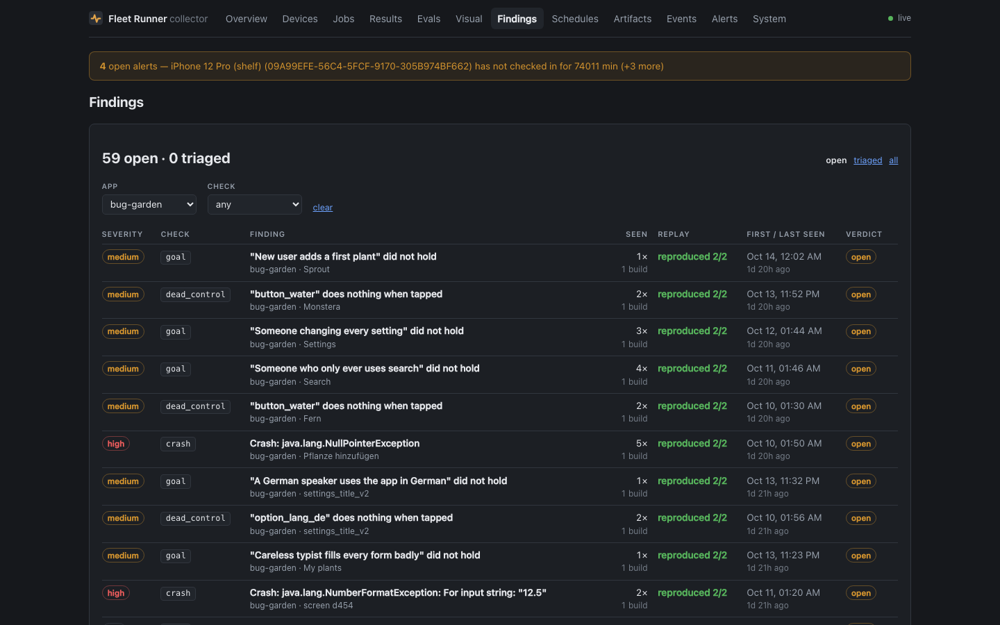

# Findings and verdicts

What a night leaves behind, and how your judgement of it steers the next one.

## The Findings page

**Findings** in the dashboard's top bar, or <kbd>g</kbd> <kbd>f</kbd>.



The **list** can be filtered by app, check and status (open, triaged, all).
Each row shows severity, check, title, screen, how many times and on how many
builds it has been seen, how it replayed ("reproduced 2/2", "flaky 1/2",
"crash log"), and when it was first and last seen.

The **detail** view shows the screenshot, the steps in words, the detail text
with every replay's outcome, links to the contact sheet, trajectory, log and
replay file, and five buttons:

| Button | Key | Means | Counts towards precision |
|---|---|---|---|
| **Real** | <kbd>r</kbd> | A bug in the app | Yes, as a hit |
| **Duplicate** | <kbd>d</kbd> | The same problem as another finding (pick which) | No |
| **Not a bug** | <kbd>n</kbd> | The app is fine; the check was wrong | Yes, as a miss |
| **Agent's mistake** | <kbd>a</kbd> | The explorer did something odd and reported its own doing | Yes, as a miss |
| **Fixed** | <kbd>f</kbd> | Real, and a fix has merged. Only after Real | Yes, as a hit |

A note is optional and is kept with the verdict. Setting the verdict to none
reopens a finding. A duplicate follows its chain to the original, and a loop is
refused. The keys are ignored straight after <kbd>g</kbd>, so <kbd>g</kbd>
<kbd>r</kbd> still goes to Results.

**Fixed** is greyed out until a finding is Real (the collector refuses it
otherwise, with a 409). It turns the finding's replay flow into a regression
test; see [Regression tests](#regression-tests). Once a finding has one, a
**Regression test** panel shows its state, its last run and the verdict
history.

A **precision table** at the top shows, for every check that has verdicts, how
often it was right and whether it has been switched off.

## Precision and switching checks off

For each app, check and visual class:

```
precision = real / (real + not a bug + agent's mistake)
```

Duplicates are left out of both sides: one noisy finding that recurs nightly
should not decide its class's fate on its own.

Once **ten** are judged, a class under **30%** is switched off at the start of
the next night for that app. A visual class (say `low_contrast`) is switched off
on its own; the judge is told not to report it and the rest keep running. Any
other check is switched off whole. **Crashes and ANRs are never switched off**:
their evidence is the platform's own log, not a judgement.

## Regression tests

A finding that was real and is fixed becomes a test, with no hand-copying:

| Verdict | What happens to the finding's replay flow |
|---|---|
| **Real** | Copied into the collector's `regressions` table as a **candidate**. Not run yet |
| **Fixed** (only after Real) | The candidate becomes **active**. A finding marked Real before this release goes straight to active |
| **Duplicate**, **Not a bug**, **Agent's mistake** | A candidate or active test is **retired** |
| Real again, on a retired one | Back to **candidate** |
| Reopen (none) | Left as it is |

The flow is copied into the database, not written to the lab's flows
directory: that directory is outside git and outside any backup this
repository controls, and a copy in the database also outlives the artifact
store's garbage collection. A finding with no replay file (some crashes) or
whose file the store has already collected gets no test, and the verdict's
answer says so.

**How a test runs.** Nothing is scheduled automatically. An app's nightly
`ui-test` opts in once with `params.regressions` (the app key the findings are
filed under, or `true` for `app.name`), and from then on every finding marked
Fixed is in the next night's run. The executor pulls the app's active flows
from the collector at run time and runs each, after the suite's own flow, on
every device of the same platform. See [ui-test](../workloads/host.md#ui-test).

**What it asserts.** For a **crash** or **ANR** finding on Android, the
executor reads the crash buffer (`logcat -b crash`, and `am_anr` in the events
buffer) before and after the flow; a new crash of the package during it is the
bug coming back. For **every other check** (frozen, blank, left_app, a11y,
visual, goal, dead_control) the oracle that found the bug was a model or a
heuristic the flow does not carry, so the honest claim is weaker: **the flow
replays without error**. Such a flow failing fails the device's row but does
not reopen anything, because a step that no longer replays may be the bug or
may be a redesigned screen. On iOS no crash buffer is read, so a crash
finding's flow is also "replays without error" there, and its detail says so.
tvloop flows (a Roku's) are kept but not run: ui-test drives Maestro.

**When it comes back.** A run that reproduces the crash reopens the finding:
the verdict is cleared, it is counted as seen once more, the build is added to
its builds, and its history gets a line such as `regressed on build 1.4 (12)
(job nightly-ui-…, R58M…): the app crashed again during the flow: …`. The
device's row fails with `regression #N reproduced (finding reopened)`. Three
devices reproducing it in one job reopen it once. The test stays active, so
the nightly keeps failing until the finding is marked Fixed again.

**Not verified:** no nightly on the lab has run a regression flow yet; the
logic is covered by the collector's suite against fake crash readings and a
fake Maestro, not by a phone. GitHub issues are only ever created, never read
back, so an issue being closed does not mark a finding fixed; the verdict is
the only trigger.

## The morning digest

Set on the collector:

```bash
FLEET_ALERT_WEBHOOK=https://ntfy.sh/your-topic    # the same webhook alerts use
FLEET_FINDINGS_DIGEST_AT=07:30                    # local time
FLEET_FINDINGS_DIGEST_HOURS=24                    # how far back; default 24
```

Once a day at that time, a plain-text digest of findings first seen (or seen
again) in the window, grouped by app with the top titles and a link, goes
through the same sender as alerts. Nothing is sent on a day with nothing new,
and a restart does not send twice. Findings judged not a bug, agent's mistake
or duplicate are left out. `FLEET_DASH_URL` sets the address used in its links.

Below the findings, one line says how the jobs that finished in the same window
ended — done, failed, and skipped on a count of its own — and names up to three
schedules that skipped, with the reason each gave:

```text
Jobs, last 24h: 14 done, 1 failed, 4 skipped (nothing ran).
- skipped: explore-tv x3 (no device matches this job on ultra)
- skipped: nightly-tvloop-hardware (no Roku developer password on this host)
```

The send rule is unchanged: a day with no findings sends nothing, whatever the
jobs did. A schedule that keeps skipping has [its own alert](../deploy/alerts.md#a-schedule-that-keeps-skipping).

## GitHub issues (off by default)

Fleet Runner stays disconnected from the app repositories until that is decided
otherwise, so this defaults to a **dry run**, exactly like commit statuses.

An issue is composed when a finding is first stored and either reproduced on
every replay or is a crash. It gets a title, a Markdown body (steps, check,
build, device, replay status, links; model-written text inside code fences, so
no @mention in it pings anyone) and the label `night-qa`. It is capped at five
new issues per app per 24 hours, dry runs included.

It is only ever **sent** when all three are set:

```bash
FLEET_GITHUB_ISSUES=1
FLEET_GITHUB_TOKEN=…
FLEET_FINDINGS_REPOS='{"greenfolio":"addisdev/greenfolio-android"}'
```

Until then, `GET /api/findings/issues` lists what would have been filed. The
collector only ever creates issues: it never edits, comments on or closes one.
A failed send is not retried, because a timeout can hide an issue that was in
fact created.

| Issue state | |
|---|---|
| `dry_run` | Composed, not armed |
| `pending` · `filed` · `failed` | Armed: sending, sent (with its URL), refused |
| `capped` | Over the day's five; retried the next time the finding is seen |
| `no_repo` | No repository mapped for the app; retried likewise |

## The API

### `POST /findings`

From executors. A protocol route, like `POST /results`: by default the
collector's access control for executors is the network, not the dashboard
token, and with `FLEET_AUTH_PROTOCOL=token` it needs a token with the `agent`
scope ([Authentication](../deploy/auth.md)). The body is an
`ExploreFinding`:

```json
{
  "fingerprint": "5b1e…",
  "app": "bug-garden", "build": "fixture-1", "platform": "android",
  "device_id": "emulator-5554", "job_id": "explore-try-1", "mission_id": "explore-careless-typist",
  "check": "crash", "subclass": null, "severity": "high",
  "title": "Crash: java.lang.NullPointerException",
  "detail": "java.lang.NullPointerException (after step 4 on Add plant) Replays: …",
  "screen": "02c1db49ee", "screen_name": "Add plant",
  "steps": ["On \"My plants\":", "  Tap \"Add plant\"", "…"],
  "replay": { "kind": "maestro", "sha256": "…", "attempts": 2, "reproduced": 2 },
  "artifacts": { "shot": "…", "sheet": "…", "trajectory": "…", "log": "…", "replay": "…" }
}
```

| Reply | When |
|---|---|
| `201 {id, new: true, seen_count, issue}` | A new finding |
| `200 {id, new: false, seen_count, issue}` | Seen before: the count, last-seen time and builds go up; the replay is replaced only by a better one; severity only rises; the first title, steps and evidence stay; the verdict is never touched |
| `400` | A missing field, an unknown check, a bad severity or hash, `reproduced > attempts` |
| `413` | A body over 128 KB |
| `422` | A replay that reproduced 0 times, or `replay: null` on anything but a crash |

`check` is one of `crash anr frozen blank left_app a11y visual goal
dead_control`. `subclass` is the visual judge's class. Earlier releases also
listed `regression`, `agent_stuck` and `leash`, which nothing raised; they are
refused now. A refused action is on the mission's steps (`refused`), not a
finding.

### Reading

| Method & path | |
|---|---|
| `GET /api/findings?app=&check=&status=open\|triaged\|all&verdict=&since=&limit=&offset=` | Newest last-seen first; up to 500. `since` takes ISO 8601 or a span such as `24h` |
| `GET /api/findings/:id` | One finding, with its duplicates, evidence links, replay flow, regression test and verdict history |
| `GET /api/findings/precision?app=&min=10` | `{floor, min, classes[], disabled[]}`; the workload reads `disabled` at the start of a night |
| `GET /api/findings/digest?hours=12` | The digest, as text and as data |
| `GET /api/findings/issues` | Every issue composed, dry run or filed |

### Writing

| Method & path | |
|---|---|
| `POST /api/findings/:id/verdict` | `{verdict: "real"\|"duplicate"\|"not_a_bug"\|"agent_mistake"\|"fixed"\|null, note?, duplicate_of?}`. Needs `X-Fleet-Token` when `FLEET_DASH_TOKEN` is set. `fixed` before `real` is a 409. Answers with the finding, its regression test and `change`, one sentence on what the verdict did to the test |

The same reads and the verdict are in the control API as `GET
/api/v1/findings`, `GET /api/v1/findings/{id}` and `POST
/api/v1/findings/{id}/verdict` (scope `run`, audited); both call the same
functions. See [Control API](../api.md#findings).

### Regression runs (executors)

Protocol routes, like `POST /findings`:

| Method & path | |
|---|---|
| `GET /findings/regressions?app=&state=active&platform=` | `{regressions: [...]}`, each with its flow text. `state` is `candidate`, `active` (default), `retired` or `all` |
| `POST /findings/:id/regression` | `{job_id, device_id, build, outcome: "passed"\|"reproduced"\|"failed"\|"skipped", detail}`. `reproduced` on an active test reopens the finding |

## Retention

A finding's artifacts are kept as long as the finding is. A night's run
artifacts (`explore-run-*`: full trajectories and contact sheets) are offered
for garbage collection after seven days unless a finding links them or someone
pinned them.
